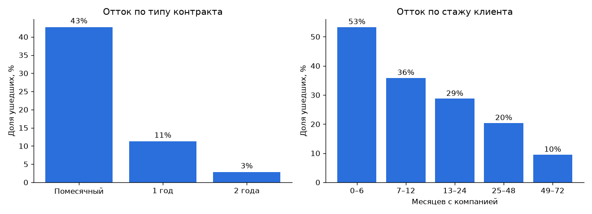

# Прогнозирование оттока клиентов

Учебный проект в рамках производственной практики в компании **Setec** (системный интегратор: ИТ-инфраструктура, информационная безопасность, сервисное обслуживание и ИТ-аутсорсинг).

**Цель:** выявить риски потери заказчиков.
**Задание:** построить модель на основе данных (частота взаимодействий, срок контракта) с помощью логистической регрессии.
**Применение:** удержание клиентов.

## Данные

Реальные данные о клиентах компании конфиденциальны, поэтому методика отработана на открытом датасете
[IBM Telco Customer Churn](https://www.kaggle.com/datasets/blastchar/telco-customer-churn) (7 043 клиента).

| Требование задания | Признак в данных |
|---|---|
| Срок контракта | `Contract` (помесячный / 1 год / 2 года), `tenure` (стаж, мес.) |
| Частота взаимодействий | `NumServices` — число подключённых услуг (рассчитывается) |

## Результаты

- ROC-AUC: **0,844** (5-fold CV), **0,833** на тестовой выборке
- Recall по ушедшим клиентам: **0,78**
- Договор на 2 года снижает шансы ухода в ~4 раза, на 1 год — в ~2 раза; отток максимален в первые 6–12 месяцев
- Сегмент «высокий риск» (34% клиентов) содержит 71% всех ушедших

| Тип контракта | Отток |
|---|---|
| Помесячный | 43% |
| 1 год | 11% |
| 2 года | 3% |



## Структура

```
research.ipynb   — полное исследование: EDA, стат. тесты, модель, интерпретация, выводы
data/                  — датасет IBM Telco Customer Churn
results/               — метрики, коэффициенты, оценки риска по клиентам, графики
```

## Запуск

```bash
python3 -m venv .venv
.venv/bin/pip install -r requirements.txt
.venv/bin/jupyter lab churn_research.ipynb  # ноутбук
```
